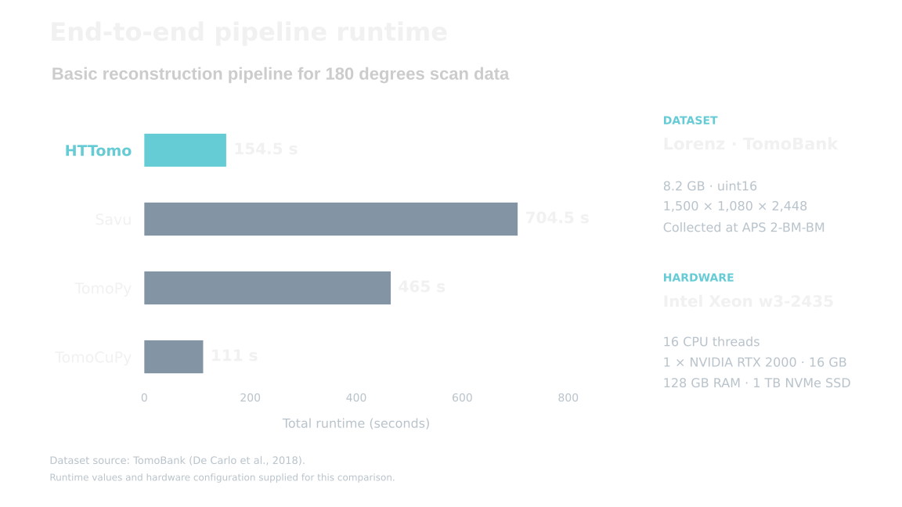
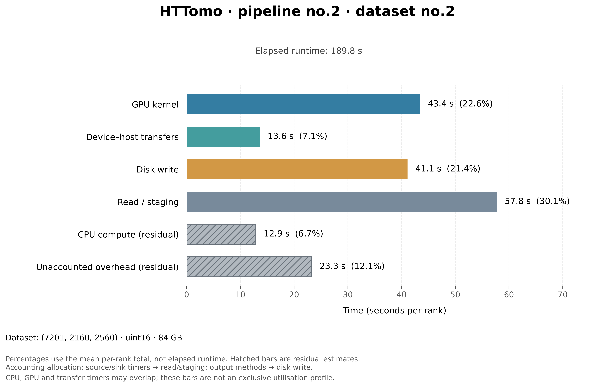
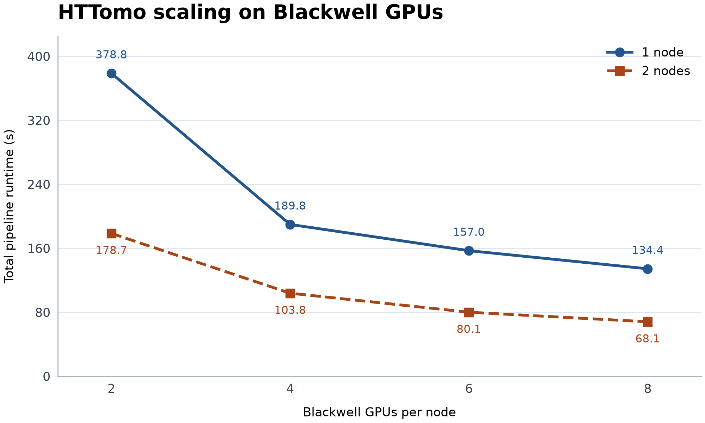
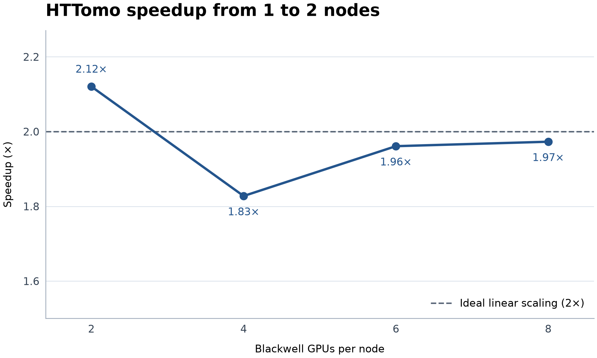
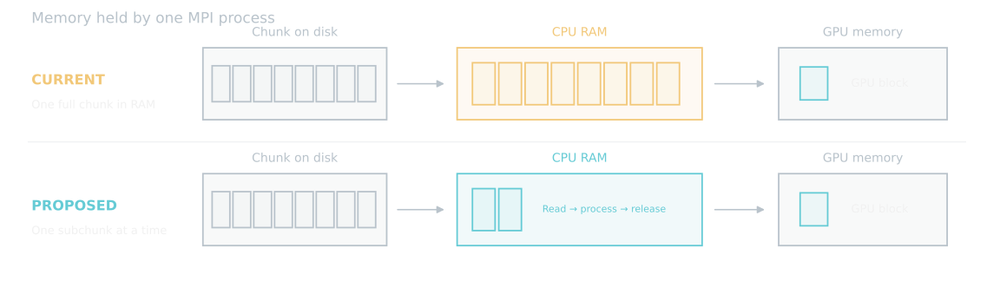
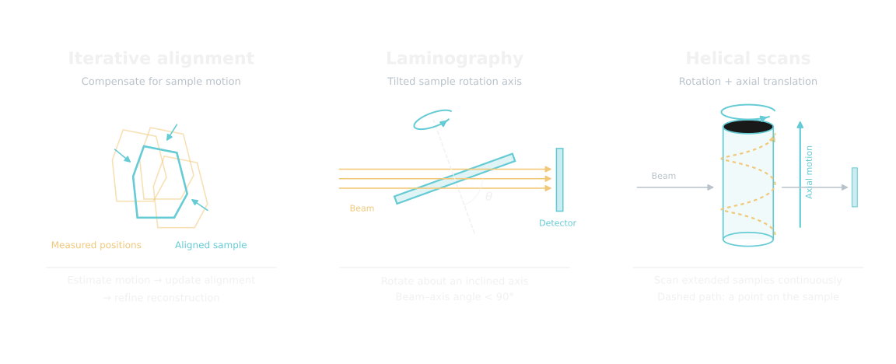
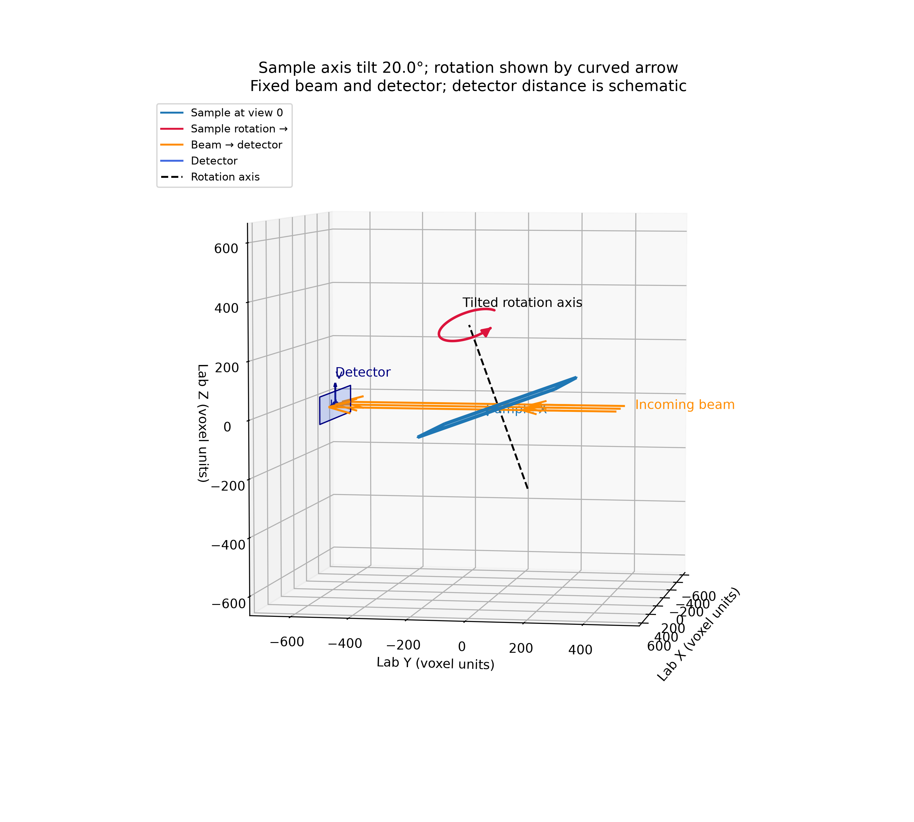
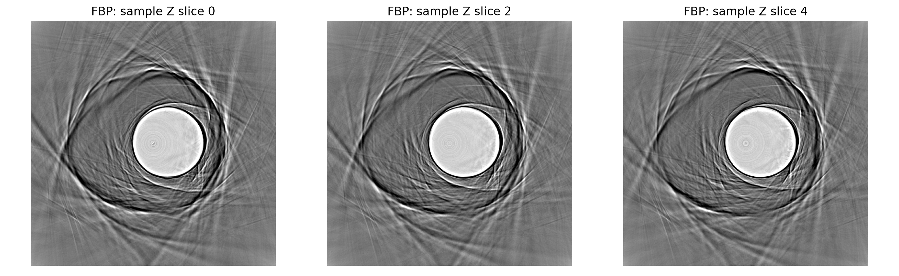
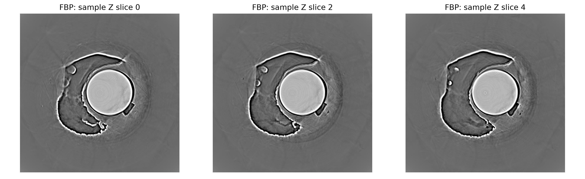

## 

{
  width=100%
  fig-alt="DLS"
}

::: {.footer}
[Diamond Light Source](https://www.diamond.ac.uk/Home.html)
:::

## 

{
  width=100%
  fig-alt="Examples of tomography software associated with ESRF, APS and PSI"
}

:::{.footer}
[Tomopedia](https://tomopedia.github.io/software/)
:::

## What is HTTomo?

**High-throughput tomographic software HTTomo is open-source software for parallel-beam tomography data processing and reconstruction.**

It is designed for high-throughput processing, i.e., handling large amounts of scan data with computational efficiency.

::: {style="text-align: center; margin: 1.2em 0; padding: 0.7em 0; border-top: 2px solid #66c2d7; border-bottom: 2px solid #66c2d7; font-size: 1.2em;"}
**Load scan data → Correct the images → Reconstruct → Save results**
:::

:::: {.columns}
::: {.column width="48%"}

::: {.fragment}

### You provide

- **Scan data:** X-ray images taken at different angles saved into a data file. 
- **A processing recipe:** a YAML text file listing the steps or methods and their parameters.

:::

:::
::: {.column width="48%"}
::: {.fragment}

### HTTomo handles

- Running the processing steps in recipe order.
- Managing data and memory, with support for GPU processing and HPC clusters.

:::
:::
::::

## Input and output in tomography {#input-output}

<video data-autoplay autoplay loop muted playsinline controls preload="auto" poster="images/tomography-collection-reconstruction-poster.png" style="width: 100%; max-height: 650px;" aria-label="Synthetic tomography animation: radiographs accumulate over acquisition angles while the central reconstructed slice updates.">
  <source src="images/tomography-collection-reconstruction.mp4" type="video/mp4">
</video>

::: {.notes}
Illustrative synthetic data. Each radiograph is generated from the same 3D
sample, and the displayed central slice is reconstructed by FBP from the
projections acquired so far. The centre panel shows the accumulating sinogram
for that slice. Limited-angle artefacts decrease as angular coverage increases.
This animation explains the input/output relationship and accumulation; it
does not claim an existing live-acquisition integration in HTTomo. Flat/dark
calibration and other preprocessing steps are omitted from the illustration.
:::

## What else is HTTomo?

:::: {.columns}

::: {.column width="27%"}
{width=90% fig-alt="HTTomo logo"}
:::

::: {.column width="68%"}

- Written in **Python**, using object-oriented design.
- A framework for **parallel data processing**.
- Designed to **scale to increasingly large datasets**.
- Supports **plug-and-play processing methods** from TomoPy and in-house GPU-accelerated libraries.
- Separates processing from an **independent, replaceable user interface**.
:::
::::

::: {.footer}
[HTTomo on GitHub](https://github.com/DiamondLightSource/httomo)
:::

## HTTomo framework

- OpenMPI-based framework for **parallel processing** of tomography data
- Chunks, blocks and sections for **data partitioning**
- HTTomo memory management for **CPU and GPU** processing
- HTTomo wrappers for **plug-and-play** processing methods
- Reconstruction ecosystem
- HTTomo features

##  Open MPI in HTTomo

Open MPI is an open-source implementation of the **Message Passing Interface** standard. It launches independent processes—called **MPI ranks**—and lets them exchange data and coordinate work.

- The same program runs in every rank
- Each rank processes a different part of the dataset
- Ranks can run on one workstation or across several HPC nodes

### HTTomo uses MPI as its **high-level parallelisation layer**:

::: {.mpi-flow}
::: {.rank}
**Rank 0**
GPU 0
:::
::: {.rank}
**Rank 1**
GPU 1
:::
::: {.rank}
**Rank 2**
GPU 2
:::
::: {.rank}
**Rank 3**
GPU 3
:::
:::

- Distributes large tomography datasets as chunks across ranks
- Assigns ranks to CPUs or GPUs for concurrent processing
- Coordinates distributed I/O, processing and reconstruction

## HTTomo data management {#gpu_data_management}

:::: {.columns}
::: {.column width="48%"}

### Larger 3D blocks within the memory budget

- HTTomo divides data **chunks** into 3D **blocks** for GPU processing.
- Uses blocks as large as safely fit in GPU memory
- Memory estimators use **free VRAM** and each method’s requirements to determine how many slices fit.
- The **most memory-demanding method in a section** limits the block size.

{
  width=60%
  fig-alt="3d data block"
  fig-align="center"
}
:::
::: {.column width="2%"}
<!-- empty column to create gap -->
:::
::: {.column width="50%"}

::: {.fragment}
### Method chains to reduce transfers

HTTomo chains compatible GPU methods within a [section](#sections), keeping each block on the GPU between methods.

**For each block:**

1. Transfer the block to the GPU.
2. Run the GPU method chain.
3. Return the result to the CPU only when it is needed.

{
  width=100%
  fig-alt="Chain of 3D processing methods"
  fig-align="center"
}

:::
:::
::::

## {#mpi_figure}

{
  width=100%
  fig-alt="MPI in HTTomo"
}

## {#reslice}

{
  width=100%
  fig-alt="reslicing operation"
}

::: {.footer}
[More on reslice](https://diamondlightsource.github.io/httomo/introduction/concepts/reslice.html)
:::

## {#sections}

{
  width=100%
  fig-alt="HTTomo GPU section"
}

::: {.footer}
[More on sections](https://diamondlightsource.github.io/httomo/introduction/concepts/sections.html)
:::

## 

{
  width=100%
  fig-alt="HTTomo GPU memory estimation"
}

## {#wrappers}

{
  width=100%
  fig-alt="HTTomo wrappers"
}

## 

{
  width=100%
  fig-alt="GPU reconstruction ecosystem"
}

##

{
  width=100%
  fig-alt="HTTomo features"
}

::: {.footer}
[HTTomo features](https://diamondlightsource.github.io/httomo/howto/httomo_features.html)
:::

## Padding enables true 3D processing

A 3D method needs neighbouring slices. Padding preserves that context when HTTomo splits a volume into blocks.

:::: {.columns}
::: {.column width="42%"}

### Why padding is needed

- A **2D method** processes each frame independently, so a block boundary does not interrupt its neighbourhood.
- A **3D method** uses information along all three axes. At a block edge, it needs slices held in the neighbouring block.
- HTTomo pads the block with this surrounding data, allowing the method to satisfy its boundary conditions and avoid seam-like artefacts.

:::
::: {.column width="58%"}

::: {.fragment}

### Denoising comparison

::: {.image-row}
{fig-alt="2D denoising" fig-align="center"}

{fig-alt="3D denoising" fig-align="center"}
:::

- Consistent resolution in all three dimensions
- Better removal of volumetric artefacts and improved contrast
- Access to advanced 3D filters and iterative reconstruction methods

:::
:::
::::

## Sweeping functionality {#sweeping .small}

:::: {.columns}
::: {.column width="54%"}

### What is it

[HTTomo parameter sweeping](https://diamondlightsource.github.io/httomo/howto/httomo_features/parameter_sweeping.html) runs a method on the same input data using several values of one parameter, allowing you to compare the results and choose a suitable value.

::: {.fragment}

### When to use

Parameter sweeping is useful when automatic estimation fails or is unavailable. For example, if an automatic method cannot reliably estimate the *center of rotation of a sample*, sweeping lets you compare reconstructions and select a suitable value.

:::

::: {.fragment}

### HTTomo feature

Parameter sweeping uses a separate (non high-throughput) runner in HTTomo, designed for debugging and parameter tuning.
:::
:::
::: {.column width="45%"}

::: {.fragment}

{
  width=85%
  fig-alt="CoR sweeping"
}

::: {.caption}
Changing CoR changes the reconstruction. Each frame shows its trial value.
:::

:::

:::
::::

## HTTomo for GPU processing

HTTomo is **designed** to perform GPU-accelerated processing. This is the **preferred approach** for achieving high-throughput processing.

GPU performance comes from:

- GPU-accelerated methods: [pre-processing](#gpu_methods_preproc) and [reconstruction](#gpu_methods_recon) from the [HTTomoLibGPU](https://diamondlightsource.github.io/httomolibgpu/) and [ToMoBAR](https://github.com/dkazanc/ToMoBAR) libraries.
- [Efficient GPU utilisation](#gpu_data_management)
- Fewer transfers between CPU and GPU memory

## GPU pre-processing: execution time {#gpu_methods_preproc .benchmark-slide}

::: {.benchmark-takeaway}
GPU implementations are faster for all five tested methods, including amortised transfers.
:::

::: {.benchmark-context}
HTTomoLibGPU on Blackwell GPU versus TomoPy on a 96-core AMD EPYC CPU.
:::

{width="100%" fig-alt="CPU vs GPU methods with transfers" fig-align="center"}

## GPU pre-processing: transfer costs {#gpu_methods_preproc2 .benchmark-slide}

::: {.benchmark-takeaway}
Including transfers, the tested GPU methods achieve **6.7–29.2× speedup** over CPU implementations.
:::

{width="100%" fig-alt="CPU vs GPU methods with transfers" fig-align="center"}

## GPU reconstruction: execution time {#gpu_methods_recon .benchmark-slide}

::: {.benchmark-takeaway}
**LPRec: 1.5 s**, compared with 4.2 s for 3D FBP and 9.3 s for slice-wise FBP in this test.
:::

::: {.benchmark-context}
Data chunk: `[1800, 200, 2560]` · NVIDIA V100 GPU
:::

{width="100%" fig-alt="GPU recon comparison" fig-align="center"}

## Workstation pipeline runtimes {#workstation-benchmark .benchmark-slide}

::: {.benchmark-takeaway}
**HTTomo: 154.5 s** end to end; TomoCuPy is fastest in this comparison at 111 s.
:::

{
  width=100%
  fig-alt="DLS"
}

## Single node: where method time is spent {#single-node-methods .benchmark-slide}

::: {.benchmark-takeaway}
**Intermediate saving (33.0 s)** and **stripe removal (25.3 s)** are the largest method costs per rank.
:::

::: {.benchmark-context}
Four NVIDIA RTX PRO 6000 Blackwell GPUs · 84 GB dataset
:::

{
  width=100%
  fig-alt="Blackwell 4 GPUs run"
  fig-align="left"
}

## Single node: processing and data movement {#single-node-components .benchmark-slide}

::: {.benchmark-takeaway}
**Read/staging + disk writes: 98.9 s per rank**, compared with 43.4 s of GPU kernel time.
:::

::: {.benchmark-context}
Four Blackwell GPUs · elapsed runtime: 189.8 s · timers may overlap
:::

{
  width=100%
  fig-alt="Blackwell 4 GPUs run"
  fig-align="left"
}

## Multiple nodes: pipeline runtime {#multinode-runtime .benchmark-slide}

::: {.benchmark-takeaway}
With **8 GPUs per node**, two nodes reduce runtime from **134.4 s to 68.1 s**.
:::

{
  width=100%
  fig-alt="Blackwell multinode benchmarks"
  fig-align="left"
}

## Scaling from one to two nodes {#multinode-speedup .benchmark-slide}

::: {.benchmark-takeaway}
Doubling the nodes gives **1.83–2.12× speedup** at the same GPU count per node.
:::

::: {.benchmark-context}
Each point compares one versus two nodes using the indicated GPUs per node.
:::

{
  width=100%
  fig-alt="Blackwell multinode benchmarks"
  fig-align="left"
}

## What's next for HTTomo? {#cpu-memory-future}

### Reducing CPU memory usage

- **Current limit:** each process holds a full data chunk in RAM. Larger inputs require more RAM or distribution across more nodes.
- **Proposed redesign:** load smaller **subchunks** into CPU memory and release them after processing.

{width="100%" height="410" fig-alt="Current: a full chunk is loaded into CPU RAM before GPU blocks are processed. Proposed: stream one smaller subchunk at a time through CPU RAM, keeping GPU block processing."}

::: {style="font-size: 0.82em; color: #b9c3cb;"}
Requires changes to loading, scheduling and reslicing; methods with wider data dependencies need special handling.
:::

::: {.notes}
The proposed host-memory subchunks are distinct from existing GPU blocks. GPU
blocking limits device memory but does not remove the requirement to hold the
process's complete chunk in host RAM. Adding GPUs alone does not solve this
host-memory bottleneck. More RAM or distribution across more nodes is the
current resource-based route for a fixed workflow.

A streamed design would keep only the active subchunk and required working
buffers in host memory. Peak memory still depends on intermediate arrays,
method dependencies and overlap regions. Reslicing and methods requiring
larger/global views may need disk-backed staging or multiple passes. This is
a proposed architecture, not an implemented feature or a measured reduction;
extra I/O and communication would need benchmarking.
:::

## What's next for HTTomo?

### Supporting bespoke scanning geometries

{
  width=100%
  fig-alt="DLS"
}

## Laminography reconstruction at DIAD {#diad-laminography}

Including the **20° sample-axis tilt** reduces reconstruction artefacts with **ToMoBAR FBP**.

:::: {.diad-comparison}
::: {.diad-geometry}

<h3>DIAD acquisition geometry</h3>

{fig-alt="DIAD laminography geometry: fixed beam and detector with a sample rotating about an axis tilted 20 degrees from vertical. The curved arrow shows sample rotation."}

20° axis tilt = **70° beam–axis angle**

:::
::: {.diad-results}

<h3>Without tilt in the reconstruction model</h3>

{fig-alt="FBP reconstructions of sample Z slices 0, 2 and 4 assuming conventional tomography, showing strong streaking around the sample."}

<h3>With the 20° sample-axis tilt</h3>

{fig-alt="FBP reconstructions of sample Z slices 0, 2 and 4 using the laminography geometry, showing clearer sample boundaries and substantially reduced streaking. Some ring and edge artefacts remain."}

:::
::::

::: {.notes}
DIAD scan k11-93537. The supplied geometry image shows a 20-degree axis tilt
from detector vertical, corresponding to ToMoBAR's tilt_angle of 70 degrees
between beam and rotation axis. The supplied reconstruction panels show
sample-Z slices 0, 2 and 4 of a central preview reconstructed with ToMoBAR FBP.

This demonstrates reconstruction in ToMoBAR, rather than completed integration
of laminography into an HTTomo production pipeline. The comparison is visual:
no quantitative accuracy metric or shared grayscale calibration is supplied.
Rings and edge artefacts remain; the preview may also have limited detector
coverage. The figure's source-to-detector distance is schematic.

Sources: images/diad_laminography_geometry.png;
images/diad_laminography_no_tilt_FBP.png;
images/diad_laminography_tilt_FBP.png.
:::

## Acknowledgements

::: {.ack-intro}
HTTomo is a collective effort by software/method developers and beamline scientists at Diamond Light Source.
:::

:::: {.columns .ack-columns}
::: {.column width="22%"}

### Software developers:

- **Daniil Kazantsev**
- **Yousef Moazzam**
- **Naman Gera**
- **Jessica Verschoyle**
- **Timothy Poon**
- **Benedikt Daurer**

:::
::: {.column width="44%"}

### Beamline community

We thank Diamond’s beamline scientists for:

- Representative datasets and scientific requirements
- Software testing and validation on real experiments
- Feedback that improves methods, pipelines and usability

:::
::: {.column width="33%"}

### Diamond Light Source

We acknowledge Diamond Light Source and its technical teams for providing:

- Beamline and experimental facilities
- HPC and GPU computing resources
- Data infrastructure and operational support

:::
::::

::: {.footer}
Thank you!
:::
